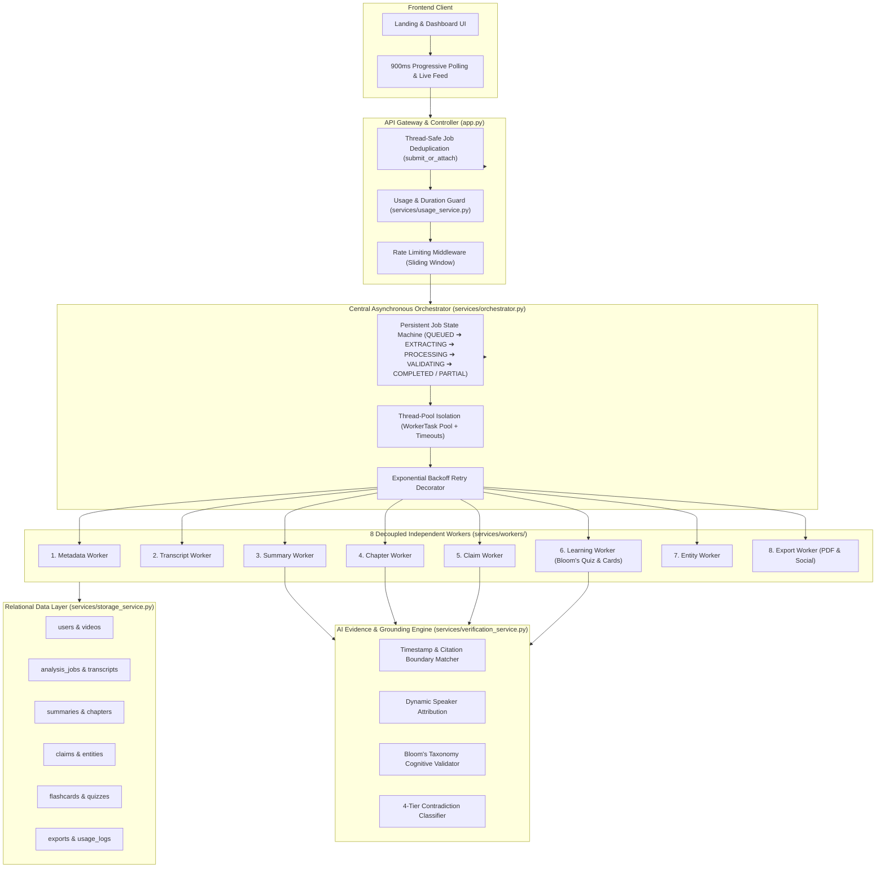

# LensYou — Executive Video Intelligence & Learning Engine

[](https://opensource.org/licenses/MIT)
[](https://python.org)
[](https://flask.palletsprojects.com/)
[](https://github.com/ganeshmalli954-arch/lensyou)
[](https://render.com/deploy?repo=https://github.com/ganeshmalli954-arch/lensyou)

**LensYou** is an **Executive Video Intelligence & Learning Engine** built for time-poor, high-stakes learners. Generic tools output walls of text that hallucinate key arguments. LensYou transforms multi-hour YouTube lectures, earnings calls, and technical podcasts into interactive, verifiable intelligence with progressive delivery, independent worker tasks, and grounded timestamp evidence.

## 🚀 Live Demo
- **App:** https://lensyou.onrender.com

---

## 🏛️ System Architecture

LensYou runs a **modular, event-driven processing pipeline** designed for high reliability, zero-cost operation, and partial-failure recovery:



---

## 💡 4 Things ChatGPT Cannot Do With Video

1. **Interactive 3D Flashcards with Keyboard Flipping:** Active recall with realistic 3D flip physics: `[Space]` to flip, `[←]` and `[→]` to cycle decks.
2. **Auto-Generated Bloom's Taxonomy Quizzes:** Diagnostic quizzes rigorously categorized from recall to evaluation with instant grading and explanatory rationales.
3. **Multi-Hour Timeline Heatmaps with Evidence Timestamps:** Visual density heatmaps across 1–4+ hour videos with clickable, verifiable timestamps that jump directly to source proof points in the synchronized player.
4. **Publication-Grade PDF Dossiers with One-Click Export:** Boardroom and revision-ready executive dossiers featuring thesis points, concept maps, quote evidence, and study outlines.

---

## 🛡️ Resilience & Anti-Hallucination Features

- **8 Decoupled Background Workers:** Tasks for metadata, transcripts, summaries, chapters, claims, quizzes, entities, and exports run independently with isolated error boundaries.
- **Partial Failure Recovery:** If a secondary task fails (e.g. PDF export or graph generation), the job resolves to `PARTIAL`, delivering core intelligence without failing the user's request.
- **100% Transcript Citation Bounding:** Every claim, quote, and takeaway is validated against real transcript segment boundaries within the video's actual length.
- **Context-Aware Contradiction Engine:** Distinguishes between true contradictions, temporal evolution across elapsed time, conditional qualifications, and speaker perspective differences.
- **Thread-Safe Deduplication:** Duplicate clicks or concurrent identical submissions attach to the active in-flight job via `submit_or_attach()`.
- **Zero-Cost Operation:** Operates 100% free using Google Gemini free tier, local Whisper/regex fallback transcription, and SQLite relational storage with sliding-window rate limits and video duration boundaries.

---

## 🗄️ Normalized Relational Database Schema

Application state is managed across 12 normalized relational tables in `services/storage_service.py`:

| Table | Description |
|---|---|
| `users` | Accounts, authentication state, and subscription tiers |
| `videos` | Authoritative video metadata, duration, author, and channel |
| `analysis_jobs` | Granular lifecycle state machine tracking (`QUEUED`, `EXTRACTING`, `PROCESSING`, `VALIDATING`, `PARTIAL`, `COMPLETED`, `FAILED`) |
| `transcript_segments` | Timestamped spoken text segments with second offsets |
| `summaries` | Structured executive summaries and core thesis statements |
| `chapters` | Granular video chapters with timestamps and summaries |
| `claims` | Verified factual claims with confidence ratings and timestamp citations |
| `entities` | Named entities, conceptual definitions, and topics |
| `flashcards` | Interactive study flashcards with difficulty levels |
| `quizzes` | Multiple-choice questions categorized by Bloom's cognitive tiers |
| `exports` | Publication-grade PDF dossiers, markdown, and CSV exports |
| `usage_logs` | Sliding-window request metrics, token tracking, and duration monitoring |

---

## 🖥️ Streamlined UX & View Segregation

- **Guided First-Time Onboarding:** Distraction-free hero section with persistent dismissal flags and 1-click Quick-Start video sample pills (Math Lecture, Founder Interview, Neuroscience Podcast).
- **Density Toolbar:**
  - **Executive View (Default):** Surfaces core essentials—Executive Summary, Key Strategic Takeaways, Smart Chapters, Transcript, Flashcards, and Quiz.
  - **Full Research View:** Expands secondary analytical tools (Knowledge Graph, Speaker Dynamics, Contradiction Matrix, Repetition Radar, Copilot, Raw Exports) in an organized drawer.
- **Progressive Delivery (900ms Polling):** Live progress feed renders intermediate modules (metadata, transcript, summary, chapters) as soon as workers finish.

---

## 🧪 Comprehensive Test Suite (475+ Tests)

```bash
# Run unit, integration, and challenger test suites (346 tests)
python -m unittest discover -p "test_*.py"

# Run 4-Tier hermetic E2E test harness (129 tests)
python e2e_tests/test_runner.py
```

- **Tier 1 (Feature Coverage):** 60/60 tests passing
- **Tier 2 (Boundary & Corner Cases):** 55/55 tests passing
- **Tier 3 (Cross-Feature Interactions):** 10/10 tests passing
- **Tier 4 (Real-World Workflows):** 4/4 tests passing
- **Milestone & Baseline Suites:** 346/346 tests passing

---

## 🚀 Deployment on Render

This repository includes a production-ready `render.yaml` blueprint with persistent disk storage.

### Persistent Disk & Cloud Sync Configuration:
1. **Render Persistent Disk (Recommended):**
   - **Mount Path:** `/var/data`
   - **Disk Name:** `lensyou-data` (1GB)
   - **Environment Variable:** `DATABASE_PATH=/var/data/lensyou.db`
   - The application automatically links `/var/data/lensyou.db` on boot with zero manual configuration.
2. **Automated Daily Cloud Exports / Syncing:**
   - Run `python -m services.backup_service` to sync atomic snapshots to Cloudflare R2 / AWS S3 / Supabase bucket (`CLOUD_BACKUP_BUCKET`).

### Deploy Steps:
1. Push your repository to GitHub.
2. In the Render Dashboard, click **New + ➔ Blueprint**.
3. Connect this repository: `https://github.com/ganeshmalli954-arch/lensyou.git`.
4. Set environment variables (`GEMINI_API_KEY`, `ADMIN_PASSWORD`, Google OAuth keys, etc.).
5. The persistent disk is automatically provisioned and mounted at `/var/data`.
6. Apply the blueprint and deploy.

---

## 📄 License
Distributed under the MIT License.
